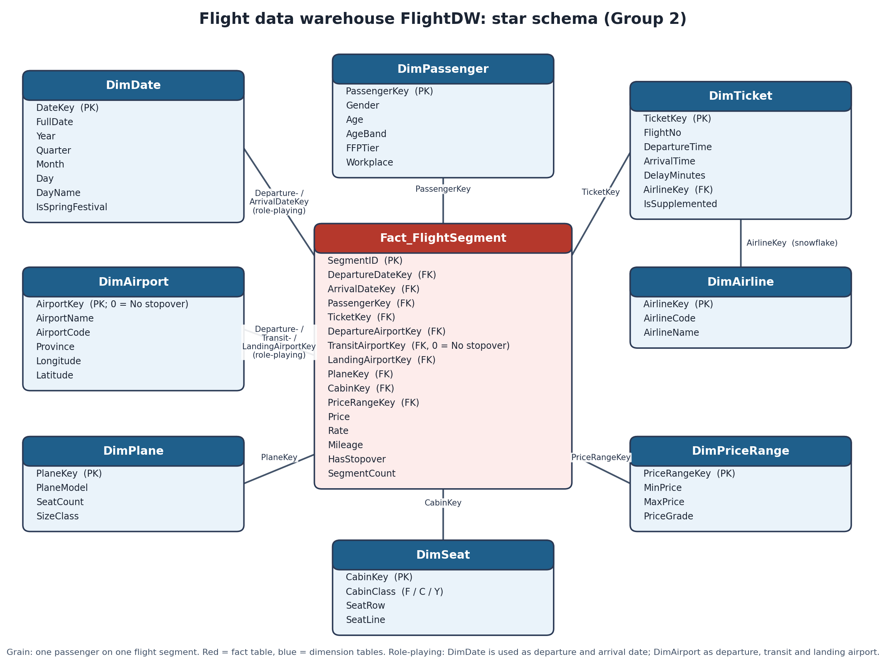
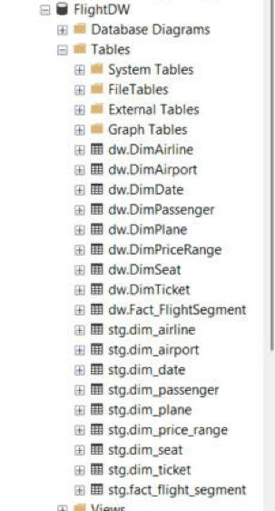
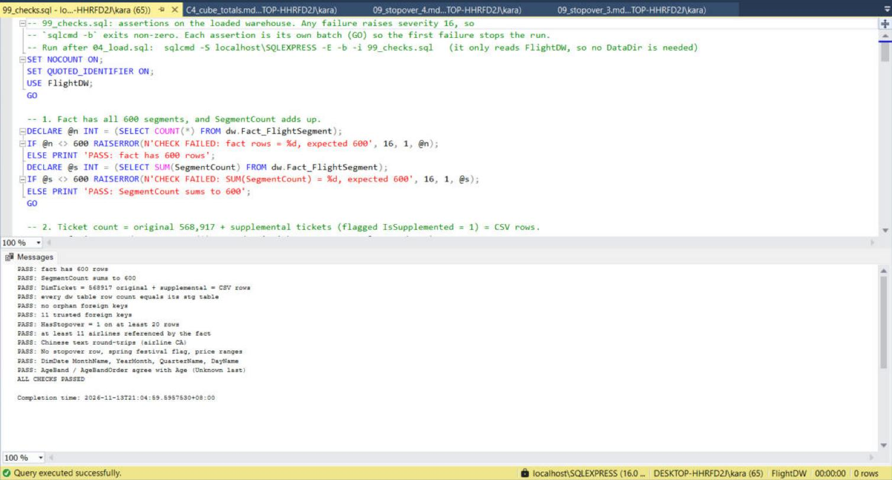
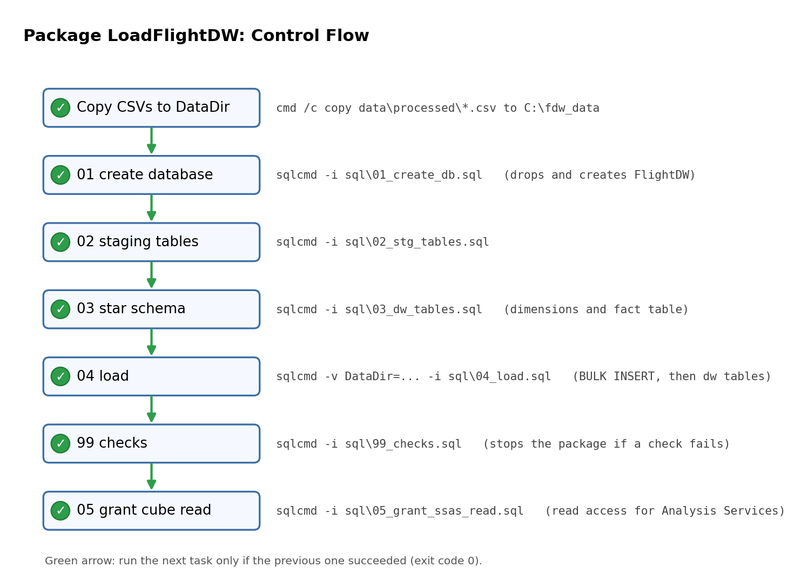
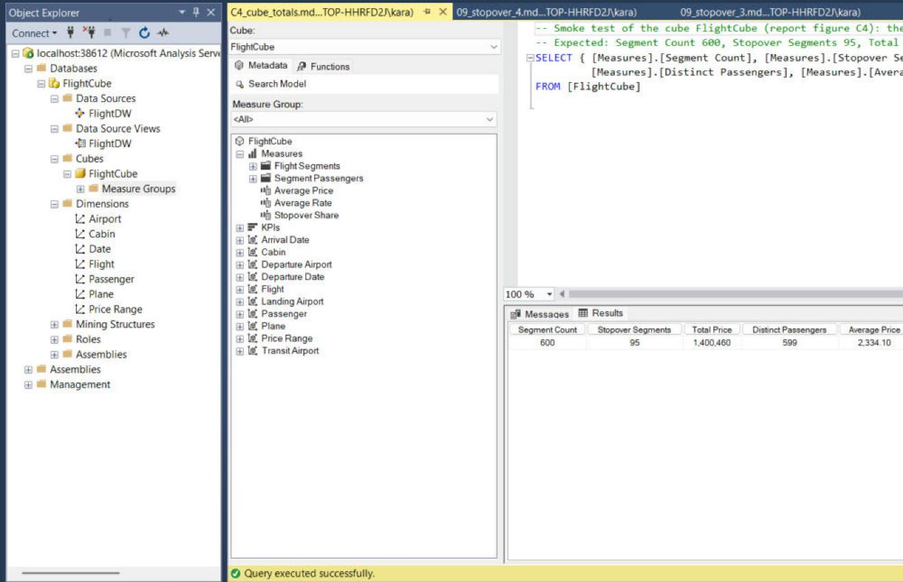
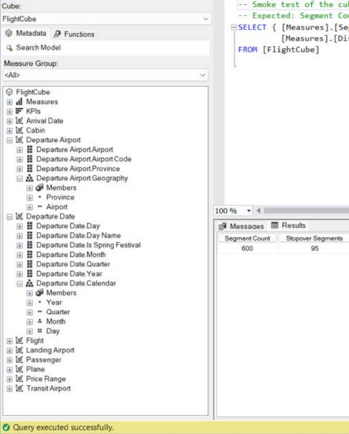
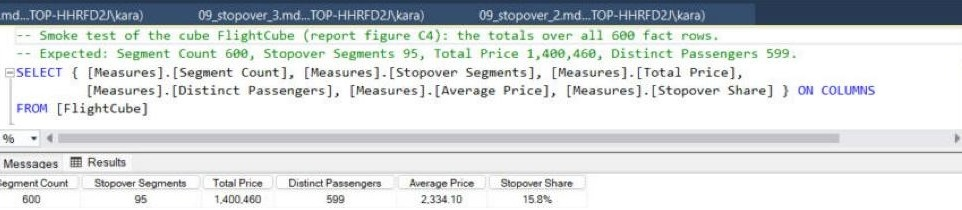

## 3.2 Logical and physical design

### Star schema

The design follows the dimensional modelling method [3]. The grain of the fact table is **one passenger on one flight segment**. `Fact_FlightSegment` holds ten dimension keys, three measures (Price, Rate, Mileage) and two derived columns (HasStopover, SegmentCount = 1). The table below lists the dimension tables and the figure after it shows the star schema.

**Table N** Dimension tables of the star schema.

| Dimension | Role in the schema |
|---|---|
| DimDate | Date, year, quarter, month, day, weekday; spring-festival flag (2021-02-11 to 2021-02-17). Used twice: departure date and arrival date |
| DimPassenger | Gender, age and age band, workplace, frequent-flyer tier |
| DimTicket | One dated flight instance: flight number, departure and arrival time, delay; snowflaked to DimAirline |
| DimAirline | Airline code and name |
| DimAirport | Name, code, province, coordinates. Used three times: departure, transit and landing airport |
| DimPlane | Model and seat count; size class (wide / narrow / small) |
| DimSeat | Cabin class (F, C, Y), seat row and letter |
| DimPriceRange | Price band and grade |



### Highlights of the design

- **Role-playing dimensions.** One airport table serves the departure, transit and landing roles; one date table serves departure and arrival dates. Only the date (not the time of day) is in the date dimension; departure and arrival times belong to the flight instance, as the course guidance recommends.
- **Stopover handling.** Direct flights point the transit key at a dedicated member `No stopover` (key 0) instead of NULL, which keeps every key mandatory and lets cube users separate direct and stopover flights.
- **Snowflaked airline.** Airline attributes live in their own table referenced from the ticket dimension, because many flight instances share one airline.
- **Derived plane size class.** The size class is computed from the seat count, because the source's text size labels are inconsistent.

### Physical design

SQL Server 2022 database `FlightDW` with two schemas: `stg` (staging tables that mirror the cleaned CSV files, loaded by `BULK INSERT`) and `dw` (the star schema with primary keys, foreign keys and checks). The load is repeatable and is followed by 10 automatic checks (row counts equal the staged files, no orphan keys, at least 20 stopover rows, at least 11 airlines, Chinese text intact). The multidimensional cube `FlightCube` is built on top of this database with Analysis Services.

The creation statement of the fact table is shown below in abridged form (several columns share a line; the ten foreign keys follow the same pattern). The complete star-schema creation script is in Appendix A; the database, staging-table, load and check scripts are in the repository folder `sql/`.

```
CREATE TABLE dw.Fact_FlightSegment (
    SegmentID           INT NOT NULL PRIMARY KEY,                 -- source row id 'ian'
    DepartureDateKey    INT NOT NULL,  ArrivalDateKey      INT NOT NULL,
    PassengerKey        INT NOT NULL,  TicketKey           INT NOT NULL,
    DepartureAirportKey INT NOT NULL,  LandingAirportKey   INT NOT NULL,
    TransitAirportKey   INT NOT NULL,                         -- 0 = 'No stopover'
    PlaneKey INT NOT NULL,  CabinKey INT NOT NULL,  PriceRangeKey INT NOT NULL,
    Price INT NOT NULL,  Rate DECIMAL(4,2) NOT NULL,  Mileage INT NOT NULL,
    HasStopover  TINYINT NOT NULL CHECK (HasStopover IN (0, 1)),
    SegmentCount TINYINT NOT NULL DEFAULT 1 CHECK (SegmentCount = 1),
    FOREIGN KEY (DepartureDateKey)  REFERENCES dw.DimDate (DateKey),
    FOREIGN KEY (TransitAirportKey) REFERENCES dw.DimAirport (AirportKey)
    -- ... eight more foreign keys, one per dimension role
);
```

### Software environment and configuration

**Table N** Software used, with versions.

| Component | Version | Role |
|---|---|---|
| Windows 11 Home | 10.0.26300 | operating system |
| SQL Server Express, instance `SQLEXPRESS` | 2022, 16.0.1000.6 | database FlightDW (schemas `stg` and `dw`), compatibility level 160 |
| SQL Server Developer, named instance `DEV` | 2025, 17.0.1000.7 | Analysis Services (Multidimensional, 17.0.25.218) and Integration Services |
| SQL Server Management Studio | 20.2 | queries, MDX and result screenshots |
| Visual Studio Community | 2019, 16.11 | SSIS and SSAS project extensions installed |
| Python | 3.10.5 (pandas 2.3.3, openpyxl 3.1.5, pytest 9.2.0, python-docx 1.2.0) | preprocessing, tests, report builder |
| PowerShell module SqlServer | 22.4.5.1 | deploys the cube and runs MDX from scripts |

**Installation order and settings.** The existing Express instance is kept for the warehouse, because Express cannot run Analysis Services; SQL Server Developer is installed next to it as a second, named instance (`DEV`) with Database Engine, Analysis Services and Integration Services, Windows authentication, and the current user as administrator. The Analysis Services server mode must be **Multidimensional** (MDX does not work in Tabular mode). The old SQL Server 2022 Developer installer is retired and stops at startup, so the current SQL Server 2025 installer is used; the 2025 Analysis Services reads the 2022 database without problems. The cube reads FlightDW through the data source `FlightDW` with Windows integrated security (provider MSOLEDBSQL, impersonation of the service account); that service account `NT Service\MSOLAP$DEV` gets read-only access (`db_datareader`) by the script `sql/05_grant_ssas_read.sql`, which must be run again after every rebuild of the database. Chinese text is kept in `NVARCHAR` columns, the CSV files are UTF-8 and loaded with `BULK INSERT` (`FORMAT = 'CSV'`, code page 65001) from `C:\fdw_data`. The cube uses MOLAP storage and is created and processed fully by one generated XMLA script. The preprocessing is deterministic (random seed 20261112). All steps are listed in `README.md`, and `tools/check_env.ps1` checks the installation.

### The warehouse in SQL Server

The database FlightDW holds the star schema in the schema `dw` and the staging tables in the schema `stg`; the first figure below lists them in Management Studio. After every load, `sql/99_checks.sql` runs automatic checks (row counts, foreign keys, stopover rows, airlines, Chinese text); all of them pass in the second figure.





The whole load can also be run as one SQL Server Integration Services package [4], `LoadFlightDW`. Its control flow has seven tasks in a chain: copy the CSV files, create the database, create the staging tables, create the star schema, load the data, run the checks, and grant the cube read access. Each task calls the same SQL script as the manual load, and a failing task (for example a failed check) stops the package. Run with the `dtexec` tool, the package completes with all seven tasks successful and the warehouse again holds 600 fact rows.



### The cube FlightCube

On top of the warehouse an Analysis Services cube (Multidimensional mode) provides the OLAP analysis. It has ten cube dimensions built from seven database dimensions: the date dimension is used twice (departure and arrival date) and the airport dimension three times (departure, transit and landing airport). Two measure groups hold the measures Segment Count, Total Price, Total Mileage, Stopover Segments and Distinct Passengers; three calculated members (Average Price, Average Rate, Stopover Share) are defined in the cube script. The hierarchies are Calendar (year, quarter, month, day), Geography (province, airport), Airline Flight (airline, flight number, ticket) and Plane Class (size class, plane model). The cube is created and processed by a generated script, so it can be rebuilt at any time; its totals (600 segments, 95 with a stopover, total price 1,400,460, 599 distinct passengers) are shown in the third figure below.






